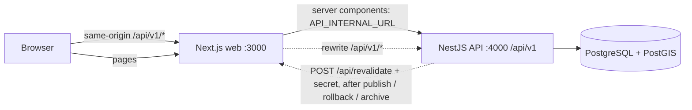

# Architecture and page map

How the pieces fit together, and which milestone delivers each page and endpoint. The spec is `PLAN.md` (§3 stack, §4 pages, §9 API). This file is a map, not a second spec: if the two disagree, PLAN wins. Fix this file in the same task.

**Status key:** **done** = exists in the repo now · **M1–M5** = planned for that milestone (PLAN §12) · **unassigned** = in PLAN §4 but not tied to a milestone yet.

## Runtime

- **Contracts:** backend `npm run openapi:export` writes `openapi.json`. Frontend `npm run contracts:generate` writes `src/contracts/api.d.ts`. Types are never written by hand.
- **Caching:** the web app fetches published data with tags `species:<slug>`, `catalogue` and `region:<slug>`. The API revalidates those tags after each publication change.
- **Publication boundary:** every public read goes through `species.published_revision_id` (see `DATABASE.md`).

## Public pages (`RedList-frontend/src/app`)

| Route | Purpose (PLAN §4) | Status |
|---|---|---|
| `/` | Home: hero, search, browse by group and environment, threatened species, places, "in this catalogue" stats | **done** (M2). No hero photo until licensed media exists (M4) |
| `/species` | Explore: search, filters, sort and page held in the URL; mobile filter drawer, chips, reset, empty and error states | **done** (M2) |
| `/species/[slug]` | Profile: the eight questions, from "What is it?" to "How do we know?" | **done** (M1, M2): eight sections, Add to compare, related species. Still to come: photos (M4), map (M3), support links admin (M3) |
| `/compare?species=a,b,c` | Compare up to 3, with no scores and no mixed units; table on desktop, stacked on mobile | **done** (M2) |
| `/map` | Map plus synced list, legend, labelled layer types; still works when tiles fail | M3 |
| `/regions/[slug]` | Country, sea or ocean page with region-aware filters | M3 |
| `/support` | Directory of reviewed support links, plus the published review criteria | M3 |
| `/about`, `/methodology`, `/sources`, `/privacy`, `/terms` | Static information pages. Real operator details are needed before launch. | unassigned (needed by M5 release) |
| `/sitemap.xml`, `/robots.txt` | SEO, published content only | M5 |
| not-found, error | Fallback pages | **done** |

Navigation: Explore · Map · Compare · About. The support directory is linked from the footer and from species context. Until their milestones land, nav links go to the 404 page.

## Staff area (`/admin`, same Next.js app)

| Area | Status |
|---|---|
| Login, sessions, CSRF | **done** (M1) |
| Species list, new species, identifiers, drafts, submit, publish, request changes, checklist | **done** (M1) |
| Form-based draft editor with source picker, live preview and diff (PLAN §7); M1 edits content as validated JSON (DECISIONS D-011) | open, unassigned (R1) |
| Organizations and support links | M3 |
| Media upload and review queue, rollback | M4 |
| Staff invites (one-time link, no email), staff management | M4 (moved from M1; a solo admin works without it) |

## Web-app internal route

| Route | Status |
|---|---|
| `POST /api/revalidate` (secret header, tag allow-list) | **done** |

## API (`RedList-backent`, prefix `/api/v1`)

| Endpoint | Status |
|---|---|
| `GET /health/live`, `GET /health/ready` | **done** |
| `GET /species/:slug` | **done** (M1) |
| `GET /species` (q, filters, sort, page, pageSize ≤ 48) | **done** (M2) |
| `GET /filters` | **done** (M2) |
| `GET /compare?species=a,b,c` (max 3, 400 otherwise) | **done** (M2) |
| `GET /regions/:slug` | M3 |
| `GET /map?bbox&group&category` (antimeridian-aware, capped) | M3 |
| `GET /support` | M3 |
| Staff: `auth/login`, `auth/logout`, `auth/me`; `species` (list, create, get, identifiers, drafts); `revisions/:id` (get, save, submit, publish, request-changes); `sources` (list, create); `reference` | **done** (M1) |
| Staff: organizations, support links | M3 |
| Staff: media upload and review, rollback, staff management | M4 |

Swagger UI: `/api/docs` (non-production only).

## Backend modules (`src/`)

| Module | Holds | Status |
|---|---|---|
| `health` | liveness and readiness | **done** |
| `db` | Drizzle connection and `schema.ts` | **done** |
| `common` | error shape, request IDs, JSON (bigint as string) | **done** |
| `cli` | migrate, seed-regions, export-openapi, admin-create, seed-fixtures | **done**; import and links:check M4 |
| `identity` | staff sessions, CSRF + Origin guard, roles, login throttle | **done** (M1) |
| `editorial` | revisions, editorial zod schema, checklist, publish transaction, audit, revalidation, sources | **done** (M1) |
| `catalogue` | `PublishedSpeciesRepository` plus the `PUBLISHED` SQL fragment in `catalogue-sql.ts` (the only public read path): profile, list, filters, related, compare | **done** (M1, M2) |
| `geography` | regions, map, `GeoRepository` (the only home of spatial SQL) | M3 |
| `support-directory` | organizations, support links | M3 |
| `media` | uploads, `StorageAdapter`, variants, review | M4 |
