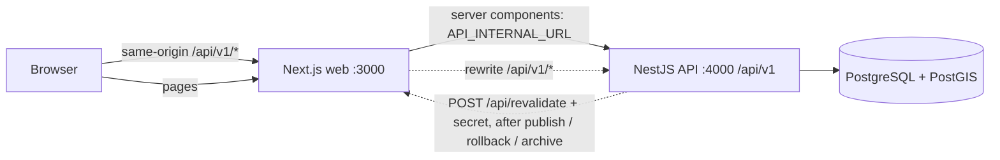

# Architecture and page map

How the pieces fit together, and which milestone delivers each page and endpoint. The spec is `PLAN.md` (§3 stack, §4 pages, §9 API). This file is a map, not a second spec: if the two disagree, PLAN wins. Fix this file in the same task.

**Status key:** **done** = exists in the repo now · **M1–M5** = planned for that milestone (PLAN §12) · **unassigned** = in PLAN §4 but not tied to a milestone yet.

## Runtime

- **Production:** Nginx in front of the same two apps, on private Docker networks, with the database reachable only by the API. See the diagram in `DEPLOYMENT.md`.
- **Security headers:** the web app sets a nonce CSP per page request (`src/proxy.ts`); the API sets a deny-all CSP in production; Nginx sets HSTS (DECISIONS D-029).
- **Contracts:** backend `npm run openapi:export` writes `openapi.json`. Frontend `npm run contracts:generate` writes `src/contracts/api.d.ts`. Types are never written by hand.
- **Caching:** the web app fetches published data with tags `species:<slug>`, `catalogue` and `region:<slug>`. The API revalidates those tags after each publication change.
- **Publication boundary:** every public read goes through `species.published_revision_id` (see `DATABASE.md`).

## Public pages (`RedList-frontend/src/app`)

| Route | Purpose (PLAN §4) | Status |
|---|---|---|
| `/` | Home: hero, search, browse by group and environment, threatened species, places, "in this catalogue" stats | **done** (M2, M4): the hero is the owner's collage (D-041), with no caption (D-055). A full-screen filmstrip of threatened species after the numbers (`SpeciesStrip`, D-067, which replaced the photo wall of D-063), then a globe with one pin per species on a place where it lives (`SpeciesGlobe`, D-064). "How we source facts" shows its three rules, then four threatened species, as large pinned photo cards (`SourceCards`, D-068) |
| `/species` | Explore: search, filters, sort and page held in the URL; mobile filter drawer, chips, reset, empty and error states | **done** (M2) |
| `/species/[slug]` | Profile: the eight questions, from "What is it?" to "How do we know?" | **done** (M1–M3): eight sections, Add to compare, related species, map with range list and region links, support links, photo (M4); its credit and licence are listed under Sources, not under the photo (D-055) |
| `/compare?species=a,b,c` | Compare up to 3, with no scores and no mixed units; table on desktop, stacked on mobile | **done** (M2) |
| `/map` | Map plus synced list, legend, labelled layer types; still works when tiles fail; "Near me" (in-browser only) | **done** (M3). Interactive since D-060: places shaded by species count, hover label, select a place to narrow the list, list rows outline their places. Self-hosted Protomaps basemap from `public/basemap/` (`npm run basemap:fetch`), Natural Earth land without it |
| `/regions/[slug]` | Country, sea or ocean page with region-aware filters | **done** (M3) |
| `/support` | Directory of reviewed support links, plus the published review criteria | **done** (M3). Criteria text needs owner review (D-018) |
| `/about`, `/methodology`, `/sources`, `/privacy`, `/terms` | Information pages. `/sources` lists every source cited by published content. | **done** (2026-11-21). The about page describes a personal portfolio project; set `NEXT_PUBLIC_CONTACT_URL` for a contact link |
| `/sign-in`, `/sign-up`, `/account` | One sign-in form for everyone: staff go on to `/admin`, visitors stay on the site (back to the page they came from). Optional visitor accounts: sign up, then on `/account` see the account, sign out, change the password or delete the account. **Sign in** sits at the top of every page; signed in, it shows the visitor's name (a person icon below lg) or Staff area | **done** (2026-11-25, D-066, owner request; R2 accounts without email) |
| `/credits` | Photo credits: credit line, licence (linked to its deed) and source of every photo on a published profile, by species; linked from the footer | **done** (2026-11-23, D-055) |
| `/sitemap.xml`, `/robots.txt` | SEO, published content only | **done** (2026-11-21), plus Open Graph with the licensed photo and schema.org JSON-LD (`Taxon`, `BreadcrumbList`, `WebSite` search) |
| all pages | Accessibility (axe, keyboard), nonce CSP | **done** (M5): `e2e/release.spec.ts` |
| not-found, error | Fallback pages | **done** |

Navigation: Explore · Map · Compare · About, then Sign in (or who is signed in; D-066). The support directory is linked from the footer and from species context.

## Staff area (`/admin`, same Next.js app)

| Area | Status |
|---|---|
| Login (on the form for everyone, `/sign-in`, D-066), sessions, CSRF | **done** (M1); device cookies against lockout abuse (D-061) |
| Staff area guard: without a session every staff page except sign-in and set-password redirects to `/` (proxy for a missing cookie, the layout for a session the API rejects); editors are sent home from `/admin/staff` | **done** (2026-11-25, D-065) |
| Species list, new species, identifiers, drafts, submit, publish, request changes, checklist | **done** (M1). The list and the species page show the published photos (D-057); the provider identifier is advice, not a blocker (D-057) |
| Form editor for photos, names, grouping, the written sections, diet tags, climate and measurements (D-057) | **done** (2026-11-23) |
| Form editor for the rows that each need a source (assessments, estimates, places, habitats, threats, citations, support links), plus live preview and a diff (PLAN §7); those are still edited as JSON (D-011) | open, unassigned (R1) |
| Organizations and support links (`/admin/support`) | **done** (M3) |
| Media upload and review queue (`/admin/media`), rollback ("Make this version live again" on `/admin/species/[id]`) | **done** (M4) |
| Staff accounts (`/admin/staff`): invite with a one-time link (no email), password reset links, roles, disable/enable, sign out everywhere; `/admin/account` (change your password); `/admin/set-password` (use a link, no session) | **done** (2026-11-24, D-062) |

## Web-app internal route

| Route | Status |
|---|---|
| `POST /api/revalidate` (secret header, tag allow-list) | **done** |

## API (`RedList-backent`, prefix `/api/v1`)

| Endpoint | Status |
|---|---|
| `GET /health/live`, `GET /health/ready` | **done** |
| `GET /species/:slug` | **done** (M1) |
| `GET /species` (q, filters, sort, page, pageSize ≤ 48) | **done** (M2). Card images carry the original `width` and `height` (D-063) |
| `GET /filters` (each group carries an `example` photo for its home tile, D-037) | **done** (M2; example 2026-11-22) |
| `GET /compare?species=a,b,c` (max 3, 400 otherwise) | **done** (M2) |
| `GET /regions/:slug` | **done** (M3) |
| `GET /map?bbox&group&category&species` (antimeridian-aware, capped), `GET /map/basemap` | **done** (M3, D-016) |
| `GET /map/pins?species=a,b,…` (≤ 48): one point inside the smallest place where each species lives, for the home globe; never for hidden-location species | **done** (2026-11-25, D-064) |
| `GET /support` | **done** (M3) |
| `GET /sources`, `GET /sitemap` (published content only) | **done** (2026-11-21, D-028) |
| `GET /credits` (credit, licence and source of every photo on a published profile; rejected images left out) | **done** (2026-11-23, D-055) |
| Staff: `auth/login`, `auth/logout`, `auth/me`; `species` (list, create, get, identifiers, drafts); `revisions/:id` (get, save, submit, publish, request-changes); `sources` (list, create); `reference` | **done** (M1). Staff species carry `publishedPhotos`, and each checklist item carries `blocking` (D-057) |
| Staff: organizations, support links (list, create, edit, approve, disable) | **done** (M3) |
| Staff: `media` (list, upload, get, preview, edit, approve, reject), `species/:id/rollback`, `PUT sources/:id` | **done** (M4) |
| `GET /media/:key/:width.webp` (approved or live-published images only; rejected never) | **done** (M4, D-022) |
| Staff: `users` (list, invite, edit role/disabled, `:id/link`, `:id/sign-out`), admin only; `auth/password`; `auth/link/check` and `auth/link/redeem` (no session, Origin + per-IP limit) | **done** (2026-11-24, D-062) |
| `POST /auth/sign-in`: the form for everyone. A staff email signs in as staff (as `staff/auth/login`, which stays), any other email as a visitor; the answer's `kind` says which. The browser's other session ends | **done** (2026-11-25, D-066) |
| Visitor: `account/sign-up` (no session, Origin + per-IP limit), `account/me`, `account/logout`, `account/password`, `account/delete` (visitor session, Origin + CSRF) | **done** (2026-11-25, D-066) |

Swagger UI: `/api/docs` (non-production only).

## Backend modules (`src/`)

| Module | Holds | Status |
|---|---|---|
| `health` | liveness and readiness | **done** |
| `db` | Drizzle connection and `schema.ts` | **done** |
| `common` | error shape, request IDs, JSON (bigint as string) | **done** |
| `cli` | migrate, seed-regions, seed-vocab, export-openapi, admin-create, staff-link, seed-fixtures, e2e-prepare, import, links-check, validate-catalogue, status-check | **done** (M4 added import, links-check and validate-catalogue; seed-vocab came with the batch-1 ecology on 2026-11-22; R1-L added status-check) |
| `identity` | staff sessions, CSRF + Origin guard, roles, login throttle, device cookies, staff accounts and one-time links; visitor accounts with their own sessions, cookies and guard (`AccountGuard`), and the one sign-in form (`SignInController`, `StaffSignInService`) | **done** (M1; D-061 and D-062 on 2026-11-24; D-066 on 2026-11-25) |
| `editorial` | revisions, editorial zod schema, checklist, publish transaction, audit, revalidation, sources | **done** (M1) |
| `catalogue` | `PublishedSpeciesRepository` plus the `PUBLISHED` SQL fragment in `catalogue-sql.ts` (the only public read path): profile, list, filters, related, compare | **done** (M1, M2) |
| `geography` | regions, map, basemap, `GeoRepository` (the only home of spatial SQL) | **done** (M3) |
| `support-directory` | organizations, support links, public directory | **done** (M3) |
| `media` | uploads, `StorageAdapter` (local disk), image pipeline (sharp), review, public and staff serving | **done** (M4) |
| `import` | import file schema (zod) and the import engine; hand-checked IUCN status sheet and its import (`status-check.ts`, D-032) | **done** (M4, R1-L) |
| `quality` | `validate:catalogue` checks (PLAN §11) | **done** (M4) |
| `common/safe-fetch` | SSRF-safe outbound fetcher (D-026) | **done** (M4) |

## Operations (backend repo)

| Piece | Holds | Status |
|---|---|---|
| `Dockerfile`, `../RedList-frontend/Dockerfile` | production images | **done** (M5) |
| `deploy/docker-compose.prod.yml`, `deploy/compose.sh`, `deploy/nginx/` | production stack: private networks, migrate step, health checks, Nginx | **done** (M5, D-030) |
| `scripts/backup.sh`, `scripts/restore.sh` | PostgreSQL + media backup and restore, rehearsed | **done** (M5) |
| `.github/workflows/ci.yml` (both repos) | CI on standard GitHub-hosted runners (D-033) | **done** (R1-L); first run on the owner's push |
| `docs/launch/` | launch-readiness sheets and checklists for people to run: STATUS_CHECK, A11Y_MANUAL_CHECK, USER_TASKS, OWNER_REVIEW | **done** (R1-L) |
