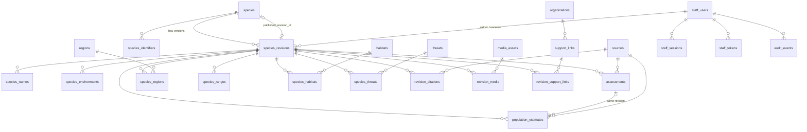

# Database

PostgreSQL 16 + PostGIS 3.4. Schema: `src/db/schema.ts`. Migrations: `drizzle/`.

| Migration | Contents |
|---|---|
| `0000_extensions.sql` | `CREATE EXTENSION postgis` |
| `0001_init.sql` | Generated by drizzle-kit: enums, 25 tables, FKs and indexes (GiST on geometry) |
| `0002_integrity.sql` | Hand-written: composite FKs, CHECKs, immutability and append-only triggers, name full-text index |
| `0003_geometry_bounds.sql` | Hand-written (M3): range and region geometry must lie inside -180…180 / -90…90 (antimeridian-safe storage) |

## Model



## Rules

1. **Everything public about a species belongs to a revision.** `species` holds only stable identity: slug, accepted name, rank, sensitivity and the publication pointer. Public queries must join through `species.published_revision_id`. There is no other route to child rows.
2. **Publishing** happens in one transaction: validate, set the revision's `state = 'published'`, then switch the pointer. A trigger rejects a pointer to a non-published revision, and a composite FK `(published_revision_id, id) → species_revisions(id, species_id)` rejects another species' revision.
3. **Immutability:** once a revision is `submitted`, its content cannot change. Child-table triggers reject any insert, update or delete unless the parent revision is a `draft`. To edit, copy the published aggregate into a new draft (application code, milestone M1).
4. **Population estimates:** the `form` determines which of point, min, max and qualitative_text must be filled. `unknown` has no numbers, never a zero. Values are `bigint` and serialized to JSON as strings.
5. **Scope:** `regional` requires `region_id` and `global` forbids it. This applies to both assessments and estimates.
6. **Geometry:** `geometry(MultiPolygon,4326)`, `ST_IsValid`, at most 50,000 vertices. Natural Earth shapes are already split at ±180, and the Fiji test covers this.
7. **Audit:** `audit_events` rejects UPDATE and DELETE.

## Planned evolution (documented, not built)
- Diet and climate tags live in revision `editorial` JSONB. Move them to tables only when a real filter needs them.

## Regions
`npm run db:seed:regions` loads 177 countries and 29 ocean/sea/bay areas from Natural Earth 1:110m (public domain). It upserts by slug and is idempotent.

## M1 notes
- No schema change was needed (DECISIONS D-013). The integrity triggers from `0002_integrity.sql` are what make drafts safe: child rows can only change while their revision is a `draft`.
- **Public read path:** `src/catalogue/published-species.repository.ts` takes the revision id only from `species.published_revision_id` and keys every child query by it. The draft-leakage test in `test/integration/publication.spec.ts` guards this.
- **Staff read/write path:** `src/editorial/revision-content.repository.ts` loads or replaces one revision's child rows by id. It is never used for public output.
- **Publish** locks the `species` row `FOR UPDATE`, which serializes concurrent publishes of the same species (D-012).

## M2 query plans
Every public list query is built from the `PUBLISHED` fragment in `src/catalogue/catalogue-sql.ts`: species joined to its published revision. Per-species details come from LATERAL lookups keyed by `revision_id`.

`EXPLAIN (ANALYZE)` of `GET /species?q=fictus&environment=terrestrial&category=CR,EN&sort=status` on `wild_e2e` (5 species, 2026-11-21), abridged:
```
Limit → Sort (severity, name, slug) → Nested Loop Semi Join
  Hash Join species ⋈ species_revisions            (Seq Scan: 5 rows)
  LATERAL common name   → Index Scan species_names_uq (revision_id, name_type)
  LATERAL headline      → Bitmap Index Scan assessments_revision_idx
  LATERAL primary image → Bitmap Index Scan revision_media_uq
  EXISTS environment    → Bitmap Heap Scan species_environments
```
**Honest limit:** with 5 rows the planner prefers sequential scans on `species` and `species_revisions`, so this plan says nothing about behaviour at scale. What it does show is that every per-species lookup uses a `revision_id` index. The name search uses `species_names_fts` (GIN) when it is selective enough. Re-check this with the real catalogue (M4) and record p95 with test conditions (PLAN §11).

## M3 geometry
- **Ranges are revision content.** They are saved with the draft (`RevisionContentDto.ranges`), copied into new drafts, and published through the workflow. All writes and reads of geometry go through `src/geography/geo.repository.ts`.
- **On write:** the input must pass `ST_IsValid`. It is then split at ±180 with `ST_WrapX`, repaired, and must have at most 50,000 vertices. Sensitive species follow DECISIONS D-017: `generalize_country` stores the union of whole countries, and `hide_regions` cannot have ranges.
- **On read:** profiles get range metadata only. Shapes come from `GET /map`, clipped to the viewport and simplified, with species and vertex caps (D-016).

`EXPLAIN (ANALYZE)` of the map viewport match on `wild_e2e` (6 species, bbox `0,55,20,72`, 2026-11-21), abridged:
```
Nested Loop
  Bitmap Heap Scan species_revisions (state = published)
    SubPlan: Index Scan species_ranges_geom_gist   (geom && envelope, then ST_Intersects)
    SubPlan: Index Only Scan species_ranges_revision_idx
    SubPlan: Index Scan regions_geom_gist → Bitmap Index Scan species_regions_region_idx
  Index Scan species_published_revision_id_unique
Execution Time: 0.47 ms
```
Both spatial lookups use their GiST index. As in M2, 6 rows say nothing about scale. Re-measure with the real catalogue in M4.
