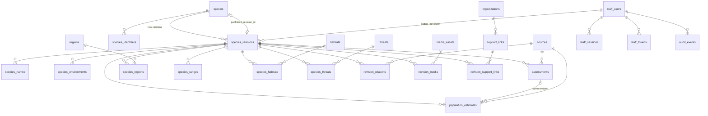

# Database

PostgreSQL 16 + PostGIS 3.4. Schema: `src/db/schema.ts`. Migrations: `drizzle/`.

| Migration | Contents |
|---|---|
| `0000_extensions.sql` | `CREATE EXTENSION postgis` |
| `0001_init.sql` | Generated by drizzle-kit: enums, 25 tables, FKs and indexes (GiST on geometry) |
| `0002_integrity.sql` | Hand-written: composite FKs, CHECKs, immutability and append-only triggers, name full-text index |

## Model

## Rules

1. **Everything public about a species belongs to a revision.** `species` holds only stable identity: slug, accepted name, rank, sensitivity and the publication pointer. Public queries must join through `species.published_revision_id`. There is no other route to child rows.
2. **Publishing** happens in one transaction: validate, set the revision's `state = 'published'`, then switch the pointer. A trigger rejects a pointer to a non-published revision, and a composite FK `(published_revision_id, id) → species_revisions(id, species_id)` rejects another species' revision.
3. **Immutability:** once a revision is `submitted`, its content cannot change. Child-table triggers reject any insert, update or delete unless the parent revision is a `draft`. To edit, copy the published aggregate into a new draft (application code, milestone M1).
4. **Population estimates:** the `form` determines which of point, min, max and qualitative_text must be filled. `unknown` has no numbers, never a zero. Values are `bigint` and serialized to JSON as strings.
5. **Scope:** `regional` requires `region_id` and `global` forbids it. This applies to both assessments and estimates.
6. **Geometry:** `geometry(MultiPolygon,4326)`, `ST_IsValid`, at most 50,000 vertices. Natural Earth shapes are already split at ±180, and the Fiji test covers this.
7. **Audit:** `audit_events` rejects UPDATE and DELETE.

## Planned evolution (documented, not built)
- Diet and climate tags live in revision `editorial` JSONB. Move them to tables only when a real filter needs them.
- Representative query plans are added to this file in M2, once the catalogue queries exist.

## Regions
`npm run db:seed:regions` loads 177 countries and 29 ocean/sea/bay areas from Natural Earth 1:110m (public domain). It upserts by slug and is idempotent.
