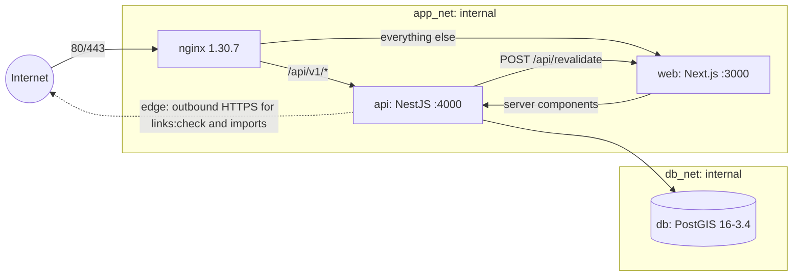

# Deployment and operations

How to run Wildward in production with Docker Compose, keep it backed up, and restore it. **Public deployment needs separate authorization from the owner (PLAN §12).** Nothing here has been deployed publicly. The stack was rehearsed locally (COMPLETED_TASKS, M5).

## What runs



| Service | Image | Published port | Health check |
|---|---|---|---|
| `db` | `imresamu/postgis:16-3.4` | none | `pg_isready` |
| `migrate` | the API image | none | one-shot: `node dist/cli/migrate.js`, then exits 0 |
| `api` | built from `Dockerfile` | none | `GET /api/v1/health/ready` (checks PostGIS) |
| `web` | built from `../RedList-frontend/Dockerfile` | none | `GET /robots.txt` (does not depend on the API) |
| `nginx` | `nginx:1.30.7-alpine` | `HTTP_BIND:HTTP_PORT` (default `127.0.0.1:8080`) | `GET /nginx-health` |

- **Start order:** `db` healthy → `migrate` exits 0 → `api` healthy → `web` healthy → `nginx`. A failed migration stops the deploy before the new API serves traffic.
- **The database is not reachable from outside.** It has no published port. Its network `db_net` is `internal`, so it has no route to the internet. Only `migrate` and `api` share that network with it; the web app and Nginx cannot reach it. The rehearsal checked each of these points.
- **Volumes:** `db_data` (PostgreSQL) and `media` (WebP variants at `/data/media`). Both are in the backup.
- **Containers:** `api` and `web` run as the unprivileged `node` user with `cap_drop: ALL`, and every service has `no-new-privileges`.

Files: `deploy/docker-compose.prod.yml`, `deploy/compose.sh` (wrapper), `deploy/.env.prod.example`, `deploy/nginx/`, `Dockerfile`, `../RedList-frontend/Dockerfile`, `scripts/backup.sh`, `scripts/restore.sh`.

## First deployment

You need a Linux host with Docker Engine and the Compose plugin, the two repos checked out side by side (`RedList-backent/` and `RedList-frontend/`), and a domain pointing at the host.

```bash
cd RedList-backent
cp deploy/.env.prod.example deploy/.env.prod
chmod 600 deploy/.env.prod
# Fill in: SITE_URL, POSTGRES_PASSWORD (openssl rand -hex 24), REVALIDATE_SECRET (openssl rand -hex 32).
# On a shared VPS, also pick a unique COMPOSE_PROJECT_NAME and a free HTTP_PORT.

# The self-hosted basemap (D-060), about 58 MB, into ../RedList-frontend/public/basemap/ before the web image is built.
# Needs Node and the pmtiles command (brew install pmtiles, or https://github.com/protomaps/go-pmtiles/releases).
# Skipping it is safe: the map then draws plain Natural Earth land.
(cd ../RedList-frontend && npm run basemap:fetch)

./deploy/compose.sh up -d --build --wait
./deploy/compose.sh ps                                  # every service healthy; migrate "Exited (0)"
curl -fsS http://127.0.0.1:8080/api/v1/health/ready     # {"status":"ok","postgis":"3.4 …"}

# Reference data and the first admin (the password is never stored in a file).
# seed-vocab loads our own habitat and threat lists (w- codes). The catalogue import files use them, so an
# import without it fails with "Unknown habitat".
./deploy/compose.sh exec api node dist/cli/seed-regions.js
./deploy/compose.sh exec api node dist/cli/seed-vocab.js
read -rs ADMIN_PASSWORD && export ADMIN_PASSWORD
./deploy/compose.sh exec -e ADMIN_EMAIL=you@example.org -e ADMIN_NAME="Your name" -e ADMIN_PASSWORD api node dist/cli/admin-create.js
unset ADMIN_PASSWORD
```

Then sign in at `/admin` and follow `docs/ADMIN_GUIDE.md`. **Never** run `db:seed:fixtures` or `e2e:prepare` in production. Both refuse to run there, and `validate:catalogue` fails if synthetic fixtures are found.

### Settings (`deploy/.env.prod`)

| Variable | Meaning |
|---|---|
| `COMPOSE_PROJECT_NAME` | Prefix for every container, network, volume and image. Must be unique on the host. |
| `SITE_URL` | Public origin, e.g. `https://wildward.example`. It is built into the web image (canonical URLs, sitemap, Open Graph) and is the API's allowed `Origin` for staff mutations. Changing it means rebuilding: `up -d --build`. |
| `CONTACT_URL` | Optional contact link on `/about` and `/privacy`. Built into the web image. |
| `POSTGRES_USER`, `POSTGRES_PASSWORD`, `POSTGRES_DB` | Database credentials. Use letters and digits only, because the password goes into a URL. |
| `REVALIDATE_SECRET` | Shared by the API and the web app's revalidate hook (at least 24 characters). |
| `COOKIE_SECURE` | `true` in production; staff cookies then use the `__Host-` prefix. Only a local rehearsal on plain HTTP sets `false`. |
| `HTTP_BIND`, `HTTP_PORT` | Where Nginx listens on the host. |
| `NGINX_SITE_CONF` | `./nginx/http.conf` or `./nginx/https.conf` (see TLS). |
| `FETCH_CONTACT` | Optional operator contact for the User-Agent of outbound fetches. |
| `BACKUP_DIR`, `BACKUP_KEEP`, `BACKUP_COPY_TO` | Backups (see below). |

### TLS
Choose one option:
- **TLS in front of the container** (recommended on a shared VPS that already runs a host Nginx, Caddy or a load balancer). Keep `HTTP_BIND=127.0.0.1` and `NGINX_SITE_CONF=./nginx/http.conf`, and proxy the host's 443 to `127.0.0.1:HTTP_PORT` with `X-Forwarded-Proto: https`. Set HSTS on the front proxy.
- **TLS in this container.** Get a certificate (for example with certbot on the host, which is free). Set `NGINX_SITE_CONF=./nginx/https.conf`, replace `example.org` in that file, uncomment the 443 port and the `/etc/letsencrypt` mount in `docker-compose.prod.yml`, and set `HTTP_BIND=0.0.0.0`. HSTS starts at one day: raise it to a year once HTTPS has worked for a while. The config passed `nginx -t` with a test certificate, but it has not served real traffic.

### Content
Imports run inside the API container, so photos land in the `media` volume:
```bash
./deploy/compose.sh exec api node dist/cli/import.js catalogue/batch-1.json --dry-run
./deploy/compose.sh exec api node dist/cli/import.js catalogue/batch-1.json --apply
./deploy/compose.sh exec api node dist/cli/validate-catalogue.js
./deploy/compose.sh exec api node dist/cli/links-check.js
```
The import files in `catalogue/` are copied into the API image at build time. A new import file therefore needs a rebuild (`up -d --build`), or `docker compose cp` into the container. Imports only create drafts: images still need approval and drafts still need review and publication in `/admin`.

## Nginx
- `/api/v1/*` → API; everything else → web. `/api/revalidate` and `/api/docs` return 404 from outside, because the API calls the web app's hook directly on the private network.
- **Rate limits** (per client IP):
  - staff login: 10 per minute, burst 10
  - the API: 30 requests/s, burst 120
  - images (`/api/v1/media/`) are not limited, because a list page loads one per card and a classroom may share one address
  - over the limit, the answer is 429
- **Uploads:** 16 MB on `/api/v1/` (`MEDIA_MAX_BYTES` is 15 MB); 1 MB elsewhere.
- **gzip** for JSON, GeoJSON, JS, CSS, SVG. The basemap goes from 573 kB to 198 kB.
- **Client address:** `X-Forwarded-For` is overwritten with the client address, never appended to. The API trusts only loopback and private-network proxies (`TRUST_PROXY=loopback,uniquelocal`, DECISIONS D-030), so the login throttle sees the real client.

## Security headers
| Response | Headers |
|---|---|
| Pages (web) | CSP with a per-request nonce (`script-src 'self' 'nonce-…' 'strict-dynamic'`, `object-src 'none'`, `frame-ancestors 'none'`, `connect-src 'self'`, `worker-src 'self' blob:`), `X-Frame-Options: DENY`, `nosniff`, `Referrer-Policy: strict-origin-when-cross-origin`, `Permissions-Policy`, `Cross-Origin-Opener-Policy: same-origin`, no `X-Powered-By` |
| API | `Content-Security-Policy: default-src 'none'; frame-ancestors 'none'; …`, `X-Frame-Options: DENY`, `nosniff`, `Cross-Origin-Resource-Policy: same-origin` (Helmet) |
| All (https.conf) | `Strict-Transport-Security`, set by Nginx only |

Details and trade-offs (for example, styles allow `'unsafe-inline'`) are in DECISIONS D-029.

## Updating
```bash
git -C ../RedList-frontend pull && git pull
scripts/backup.sh                         # always back up before an update that has migrations
./deploy/compose.sh up -d --build --wait  # migrate runs first; the api only starts if it succeeds
./deploy/compose.sh exec api node dist/cli/validate-catalogue.js
```
- **Cache:** the web container's Next.js data cache lives in its own filesystem. A rebuild creates a new container, so the cache starts empty. This matters after API contract changes (D-021). If you restart without a rebuild after changing data by hand, recreate the web container: `./deploy/compose.sh up -d --force-recreate web`.
- **Logs:** `./deploy/compose.sh logs -f api web nginx`. Nginx access logs contain client IP addresses; keep them only as long as you need them.

### Migration rollback limits
- Migrations only go **forward**. Drizzle keeps no down migrations, and `drizzle-kit push` is never used outside local development.
- Rolling back the **code** to an older image is safe only if the older code can still work with the newer schema. Additive changes (new tables, nullable columns) usually allow that. Dropped or renamed columns, new `NOT NULL` columns and tighter constraints do not.
- To undo a migration, **restore the backup taken just before the update** (below). That loses every change made since the backup, so take one right before migrating.
- Data-changing migrations must be reviewed by hand (AGENTS.md); the SQL in `drizzle/` is the record.

## Backups
`scripts/backup.sh` (run from the backend folder) writes `BACKUP_DIR/<project>-<UTC time>/` containing:
- `db.dump`: `pg_dump --format=custom --no-owner --no-privileges`, made inside the `db` container, so the client version always matches the server
- `media.tar.gz`: the `media` volume, read by a throwaway container with a read-only mount; the API keeps running
- `MANIFEST.txt`: project, time, git commit, PostgreSQL version, row counts, number of image files and sha256 sums

The script checks that both archives read back, keeps the newest `BACKUP_KEEP` backups (default 14), and with `BACKUP_COPY_TO` set also copies the backup there with `rsync`. Files are `0600` in a `0700` folder. A failed run deletes its incomplete folder.

**Keep backups off the app host (PLAN §13).** A backup on the same disk does not survive the loss of that host. Set `BACKUP_COPY_TO` to another machine you control (`user@host:/path/`, over SSH), or copy the folder off by another free route. Paid storage is not assumed.

Schedule it with cron on the host, for example daily at 03:15:
```
15 3 * * * cd /srv/RedList-backent && scripts/backup.sh >> /var/log/wildward-backup.log 2>&1
```

## Restore (runbook)
Use this to recover from data loss, to undo a bad migration, or to move to a new host.
1. **Choose the backup.** Read its `MANIFEST.txt`. If the copy on the host is gone, copy one back from off-host storage.
2. **Same code version.** Check out the `git_commit` from the manifest, or a later one: newer code migrates forward after the restore.
3. **New host only:** do "First deployment" up to `up -d --build --wait` (without `seed-regions`, `seed-vocab` or `admin-create`; the backup contains them).
4. **Restore:**
   ```bash
   scripts/restore.sh /path/to/backups/wildward-20261121T031500Z --yes
   ```
   The script:
   1. checks the sha256 sums
   2. stops `nginx`, `web` and `api`
   3. drops and recreates the database from `template0`
   4. runs `pg_restore --exit-on-error`, which recreates the PostGIS extension from the dump
   5. runs `ANALYZE`
   6. empties and refills the `media` volume
   7. starts the stack, **recreating** `api`, `web` and `nginx` so no stale page cache survives
   8. prints row counts
5. **Check:**
   - the printed counts equal those in `MANIFEST.txt`
   - `./deploy/compose.sh exec api node dist/cli/validate-catalogue.js` passes
   - a profile with a photo renders
   - staff can sign in. Sessions from before the backup come back with it; to sign everyone out, delete the rows in `staff_sessions`.
6. **Record it:** the date, the backup used, and the result.

**Rehearsed** on 2026-11-21 against the local stack, through backup → `down -v` → empty stack → restore; see COMPLETED_TASKS (M5). Repeat the rehearsal after any change to the scripts or the compose file, and at least before each release.

## Shared VPS rules (PLAN §13)
- Use an explicit `COMPOSE_PROJECT_NAME` and explicit host ports. Never use `docker compose down -v` without `-p` (the wrapper always adds it).
- `deploy/compose.sh` only ever touches the project named in its env file. Never run `docker system prune`, `docker volume prune` or similar host-wide commands on a shared host.
- Bind Nginx to `127.0.0.1` when a host proxy already owns 80/443.

## Not done
- Nothing has been deployed publicly. TLS has not been tested with a real certificate.
- Media is on a local volume only. There is no S3-compatible storage adapter (BACKLOG).
- CI workflows exist (`.github/workflows/ci.yml` in each repo, D-033) but have not run on GitHub yet; every check in COMPLETED_TASKS was run by hand.
- No external uptime monitoring or alerting; the health checks only restart containers locally.
